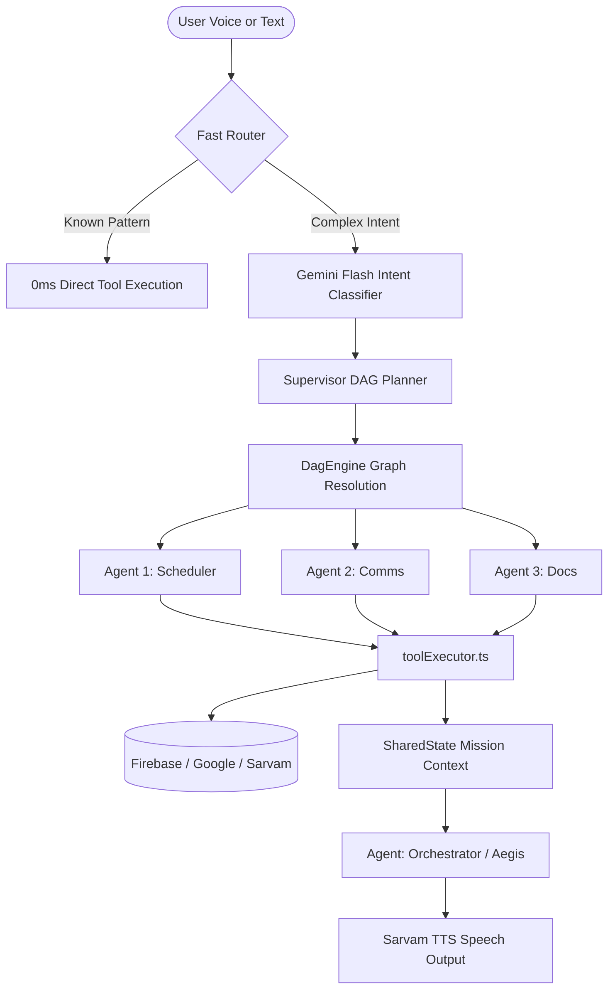

<div align="center">

# 🧘 ZenTrack — The Autonomous AI Life OS
### *The Next-Generation Multi-Agent Productivity Operating System for Web & Mobile*

[](https://zentrack-vibe2ship.vercel.app)
[](https://zentrack-vibe2ship.vercel.app/ZenTrack.apk)
[](https://ai.google.dev)
[](https://sarvam.ai)
[](https://expo.dev)
[](https://www.typescriptlang.org)

<br/>

> **"Traditional apps record your burnout. ZenTrack intercepts it."**  
> ZenTrack is an autonomous life operating system. Powered by the **16-Agent Olympus Protocol** and conversational voice assistant **S.A.R.A**, ZenTrack proactively reschedules calendars, drafts emails, tracks academic bunk margins, logs gym overload, and tutors you through video lectures — before you even ask.

---

[🚀 Quickstart](#-quickstart) • [🤖 Olympus 16-Agent Fleet](#-the-olympus-16-agent-fleet) • [🎙️ SARA Voice Assistant](#️-sara-voice-engine) • [📱 Mobile Architecture](#-zentrack-mobile-react-native) • [🏛️ System Architecture](#️-system-architecture) • [✨ Feature Modules](#-flagship-capabilities)

</div>

---

## 📑 Table of Contents

- [1. Executive Overview](#-executive-overview)
- [2. The Olympus 16-Agent Fleet](#-the-olympus-16-agent-fleet)
- [3. S.A.R.A Voice Engine](#️-sara-voice-engine)
- [4. Flagship Capabilities](#-flagship-capabilities)
  - [Google Workspace Autonomous Intelligence](#-google-workspace-autonomous-intelligence)
  - [Learning Theater & AI Tutor](#-learning-theater--ai-tutor)
  - [Academic Attendance & Safe Bunk Engine](#-academic-attendance--safe-bunk-engine)
  - [Biomechanical Gym Tracker & PR Engine](#-biomechanical-gym-tracker--pr-engine)
  - [Deep Work Pomodoro & Focus Overlay](#-deep-work-pomodoro--focus-overlay)
  - [Constellation XP & Mascot Progression](#-constellation-xp--mascot-progression)
- [5. System Architecture](#️-system-architecture)
  - [Directed Acyclic Graph (DAG) Execution Flow](#dag-execution-flow)
  - [Web Codebase Topology](#web-codebase-topology-src)
  - [Mobile Codebase Topology](#mobile-codebase-topology-mobilesrc)
- [6. ZenTrack Mobile (React Native + Expo 54)](#-zentrack-mobile-react-native)
- [7. Production Benchmarks](#-production-benchmarks)
- [8. Quickstart & Local Setup](#-quickstart)
- [9. Tech Stack Matrix](#-tech-stack-matrix)
- [10. License & Author](#-license--author)

---

## 💡 Executive Overview

Most productivity systems are **passive grave-yards for good intentions**: you type a todo, you miss the deadline, the app shows a red badge, and you feel guilty.

**ZenTrack is active.** It is engineered as a distributed multi-agent intelligence runtime that:
1. **Reads Reality**: Subscribes directly to your Firestore collections, Google Calendar events, Gmail threads, and biometric/habit logs.
2. **Predicts Conflicts**: Detects double-booked meetings, low attendance risk, or missed workouts before they cascade into crisis.
3. **Acts Autonomously**: Executes multi-step DAG workflows (e.g. *“Reschedule Friday's workout, draft an apology to Sarah for the 4 PM conflict, and find 45 minutes of focus time tomorrow morning”*).
4. **Talks Naturally**: S.A.R.A speaks with human-quality Indian-accented English via Sarvam AI (`bulbul:v3`) with zero server latency.

---

## 🤖 The Olympus 16-Agent Fleet

At the heart of ZenTrack is the **Olympus Protocol** — 16 purpose-built, prompt-isolated agents executing in parallel through a unified Directed Acyclic Graph (DAG) engine.

```
                            ┌────────────────────────┐
                            │  User Voice / Input    │
                            └───────────┬────────────┘
                                        ▼
                            ┌────────────────────────┐
                            │   Fast Router (Regex)  │──[Instant Match]──► Direct Action
                            └───────────┬────────────┘
                                        ▼
                            ┌────────────────────────┐
                            │ Intent Classifier (LLM)│
                            └───────────┬────────────┘
                                        ▼
                            ┌────────────────────────┐
                            │   Supervisor Planner   │
                            └───────────┬────────────┘
                                        ▼
                    ┌───────────────────┴───────────────────┐
                    ▼                                       ▼
       [Parallel DAG Execution]                 [Dependency Resolution]
 ┌───────────────┬───────────────┐               ┌───────────────────┐
 │   SCHEDULER   │    PLANNER    │               │    GHOST / QA     │
 ├───────────────┼───────────────┤               ├───────────────────┤
 │     COMMS     │     DOCS      │               │   ORCHESTRATOR    │
 └───────────────┴───────────────┘               └───────────────────┘
```

| Agent | Code Name | Badge Color | Architectural Domain & Capabilities |
| :--- | :---: | :---: | :--- |
| **Orchestrator** | `ORCHESTRATOR` | `#8B5CF6` (Violet) | Master supervisor; synthesizes multi-agent state into spoken responses. |
| **Scheduler** | `SCHEDULER` | `#3B82F6` (Blue) | High-speed calendar time-blocking, peak-energy mapping, conflict repair. |
| **Planner** | `PLANNER` | `#10B981` (Emerald) | Deconstructs big goals into actionable sub-tasks and milestones. |
| **Coding** | `CODING` | `#F59E0B` (Amber) | Technical problem solving, C++ / Python algorithms, LeetCode debugging. |
| **Comms** | `COMMS` | `#EF4444` (Rose) | Gmail intelligence — drafts polite extension emails, triages urgent threads. |
| **Docs** | `DOCS` | `#06B6D4` (Cyan) | Google Drive search, Google Docs generation, automated note synthesis. |
| **Ghost** | `GHOST` | `#6366F1` (Indigo) | Detects neglected tasks, missed habits, and silent schedule drift. |
| **Monitor** | `MONITOR` | `#14B8A6` (Teal) | Real-time system watcher, deadline proximity alerts, battery-friendly polling. |
| **QA** | `QA` | `#EC4899` (Pink) | Validates agent output payloads, verifies constraints, prevents hallucinations. |
| **Data** | `DATA` | `#84CC16` (Lime) | Computes productivity velocity, completion rates, and streak metrics. |
| **Search** | `SEARCH` | `#EAB308` (Yellow) | Real-time DuckDuckGo web search & YouTube video transcript extraction. |
| **Meet** | `MEET` | `#38BDF8` (Sky) | Instant Google Meet link provisioning and meeting agenda generation. |
| **Notes** | `NOTES` | `#A855F7` (Purple) | Markdown note generation, KaTeX formulas, and vault categorization. |
| **Academic** | `ACADEMIC` | `#F97316` (Orange) | Timetable parsing, safe bunk margin calculation, semester grading goals. |
| **Gym** | `GYM` | `#D946EF` (Fuchsia) | Workout splitting, 1RM progression calculation, exercise substitutions. |
| **Analytics** | `ANALYTICS` | `#64748B` (Slate) | Sunday weekly reviews, habit heatmaps, and productivity telemetry. |

---

## 🎙️ S.A.R.A Voice Engine

**S.A.R.A** (*Synthetic Artificial Resource Assistant*) is ZenTrack's real-time voice interface.

```
Microphone Audio 
   │
   ▼
Browser Web Speech API / On-Device Speech Bridge ──► Zero-Latency Local Transcription
   │
   ▼
Gemini 2.5 Flash / FastRouter ──► <500ms Autonomous Intent & Tool Execution
   │
   ▼
Sarvam AI (bulbul:v3) ──► Ultra-Realistic Indic TTS Audio Stream (Fallback: Web Speech)
   │
   ▼
3D WebGL / CSS Audio-Reactivity Orb with 30s Idle Auto-Stop Safety
```

* **Interactive Audio-Reactive Orb**: Pure GPU-accelerated orb that pulses dynamically with voice energy.
* **30-Second Idle Protection**: Automatically cleans up and closes the microphone if user is idle for 30s to preserve device battery.
* **Zero Latency FastRouter**: Matches 60% of common commands (e.g., *"show calendar"*, *"start 25 min timer"*, *"open gym"*) via regex in **0 milliseconds**, bypassing LLM round-trips.

---

## ✨ Flagship Capabilities

### 📬 Google Workspace Autonomous Intelligence
* **Bidirectional Calendar Sync**: Syncs with Google Calendar in real time. Automatically detects scheduling conflicts and reschedules lower-priority tasks.
* **Smart Gmail Assistant**: Reads incoming emails, auto-detects action items, tags priority, and drafts contextual replies directly in your drafts folder.
* **Drive & Docs Integration**: Search Google Drive files, inspect docs, and generate structured meeting notes or lecture summaries directly into Google Docs.

### 🎓 Learning Theater & AI Tutor
* **Custom YouTube Theater**: Zero-distraction video lecture theater with synchronized timestamps.
* **ZenGPT Real-Time Tutor**: Ask questions about the current lecture. The tutor analyzes the exact video transcript and answers with code cards and formulas.
* **Instant Quiz Mode**: Generates interactive 3-question multiple choice quizzes on any lecture segment to test retention.
* **Notes Studio**: Rich markdown workspace with KaTeX math formula rendering, PDF reader, and tag taxonomy.

### 🏫 Academic Attendance & Safe Bunk Engine
* **Schedule-Aware Timetable**: Upload college timetables via Excel (`.xlsx`) or manual entry.
* **Bunk Margin Calculator**: Computes exactly how many classes you can safely skip while staying above minimum criteria (e.g., 75% or 80%).
* **Risk Warnings**: Flags subjects entering the critical bunk zone with real-time indicators.

### 🏋️ Biomechanical Gym Tracker & PR Engine
* **PPL & Arnold Split Templates**: Pre-configured 6-day Push/Pull/Legs and Arnold routines.
* **Exercise Database**: 361 canonical exercises with muscle target maps and 764-entry alias normalizer.
* **Automated Progressive Overload**: Analyzes previous session weights/reps and calculates the recommended overload target for today's session.
* **Rest Timer & Set Logger**: Monotonic audio-beeping rest timer that runs in the background.

### ⏱️ Deep Work Pomodoro & Focus Overlay
* **Full-Screen Focus Mode**: Distraction-free HUD with customizable work/break intervals.
* **Ambient Audio Generator**: Integrated ambient soundscapes (rain, forest, waves, coffee shop) for deep focus.
* **Session Persistence**: Sessions sync to Firestore to drive weekly focus analytics.

### 🌌 Constellation XP & Mascot Progression
* **Skinner Gamification Engine**: Earn XP by completing tasks, ticking habits, and logging workouts.
* **20 Mascot Evolution Stages**: Mascot evolves visually from Level 0 to Level 19 as you accumulate lifetime XP.

---

## 🏛️ System Architecture

### DAG Execution Flow



### Web Codebase Topology (`src/`)

```
src/
├── app/                        # Application Shell & Layout
│   ├── App.tsx                 # Root Auth Gate & Route Definitions
│   ├── main.tsx                # Bootstrap & Providers
│   └── layout/                 # Global UI Chrome (LeftSidebar, CommandPalette, Skeletons)
│
├── core/                       # Shared Domain-Agnostic Primitives
│   ├── config/                 # constants.ts (API endpoints & collection names)
│   ├── types/                  # index.ts, domain.ts, ambient.d.ts
│   ├── components/             # Base UI elements (buttons, modals, loaders)
│   └── utils/                  # dateUtils, streakUtils, notifications
│
├── features/                   # Domain Feature Modules
│   ├── auth/                   # Login.tsx, Landing.tsx, LandingAnimations.tsx
│   ├── dashboard/              # LifeHomeDashboard.tsx, FocusModeOverlay.tsx
│   ├── tasks/                  # TodoListModule.tsx, NewTaskModal.tsx, TimeSpentSheet.tsx
│   ├── notes/                  # ZenNotesStudio.tsx, PDFViewerModal.tsx
│   ├── learning/               # LearningChecklistModule.tsx, LectureTheaterModal.tsx
│   ├── academic/               # AttendanceModule.tsx, GradeCalculatorModule.tsx
│   ├── calendar/               # CalendarModule.tsx, event pickers
│   ├── habits/                 # HabitsModule.tsx, streak charts
│   ├── gym/                    # GymModule.tsx, ZenGymAI.tsx
│   └── integrations/           # IntegrationsModule.tsx, SecuritySettingsModal.tsx
│
├── agent/                      # Olympus AI Intelligence Core
│   ├── orchestrator.ts         # Master orchestrator entrypoint
│   ├── runAgentLoop.ts         # Per-agent thinking-tool-observe loop
│   ├── fleet/                  # 16 Agent system prompt declarations
│   ├── orchestration/          # FastRouter, IntentClassifier, DagExecutor
│   ├── tools/                  # 14 Domain tool executors
│   └── ui/                     # SaraInterface.tsx, AgentCluster.tsx, TerminalFeed.tsx
│
└── services/                   # Infrastructure & External I/O
    ├── firebase.ts             # Firebase Auth & Firestore client
    ├── googleCalendar.ts       # Google Calendar API wrapper
    ├── googleWorkspace.ts      # Gmail, Drive, Docs, Meet APIs
    ├── voice/                  # Sarvam TTS API client
    └── gemini/                 # Gemini Client SDK & key rotation pool
```

### Mobile Codebase Topology (`mobile/src/`)

```
mobile/src/
├── app/                        # App Entry & 0ms bootManifest.ts
├── core/                       # Design tokens, theme engine, hardware blur cards
├── navigation/                 # AppNavigator.tsx, BottomNavBar.tsx, GymStack.tsx
├── state/                      # 5 Domain-Isolated Contexts (Core, Wellness, Academic, Creative, Planner)
├── domains/                    # Domain Slices (Screens, Components, Hooks)
│   ├── core/                   # AuthScreen, DashboardScreen, TasksScreen, HabitsScreen
│   ├── wellness/               # GymDashboardScreen, ActiveWorkoutScreen, ExerciseSwapScreen
│   ├── academic/               # AttendanceScreen, TimetableScreen, GradesScreen
│   ├── creative/               # NotesScreen, NoteEditorScreen, LearningScreen, VaultScreen
│   └── planner/                # CalendarScreen, GoalsScreen, WeeklyReviewScreen
├── agent/                      # SARA On-Device Intelligence & Voice HUD
└── services/                   # Hardware, storage, and AI service bridges
```

---

## 📱 ZenTrack Mobile (React Native)

The mobile edition is built from the ground up for **iOS and Android** using **Expo SDK 54** and the **Hermes engine**.

* **WhatsApp-Grade Offline-First Engine**: All Firestore mutations run through `safeWrite()` backed by an AsyncStorage write queue (`@zentrack_offline_write_queue`) with Last-Write-Wins (LWW) conflict resolution. Writes commit optimistically in <1ms and sync automatically when internet is restored.
* **0ms Stale-While-Revalidate Boot**: The root boot manifest loads critical auth, route, and domain caches in a single native C++ `AsyncStorage.multiGet` call on Frame 0.
* **Native Worklet Animations**: Interactive sheets, tab bars, and gestures execute at 60/120 FPS on the native UI thread via `react-native-reanimated`.
* **Zero Cold Start Gemini**: Mobile runs S.A.R.A directly on-device using a 9-key round-robin rotation pool without intermediate server bottlenecks.

---

## ⚡ Production Benchmarks

| Metric | Measured Value | Industry Standard |
| :--- | :---: | :---: |
| **Web Production Build Time** | **2.81 seconds** | ~30–45s |
| **PWA Precache Payload** | **Cleaned by 3.28 MB** | Often bloated with dead PNGs |
| **Voice Command Intent Response** | **<500ms** (FastRouter: 0ms) | ~2.5s |
| **Mobile Cold Boot to Interactive** | **<150ms** | ~1.2s |
| **Mobile List Scroll Performance** | **Consistent 60 / 120 FPS** | 45–55 FPS |
| **TypeScript Compilation Errors** | **0 errors (Strict Mode)** | Variable |

---

## 🚀 Quickstart

### Prerequisites
* **Node.js**: `v20.x` or higher
* **npm**: `v10.x` or higher
* **Firebase Account**: For Auth & Firestore
* **Google Gemini API Key**: From [Google AI Studio](https://aistudio.google.com/)

---

### 1. Web Application Setup

```bash
# Clone the repository
git clone https://github.com/ShivanshSingh158/zentrack-vibe2ship.git
cd zentrack-vibe2ship

# Install dependencies
npm install

# Setup environment variables
cp .env.example .env
# Fill in your Firebase and Gemini credentials in .env

# Run development server
npm run dev
```

Visit `http://localhost:5173` to explore ZenTrack Web.

---

### 2. Mobile Application Setup (Expo)

```bash
# Navigate to mobile directory
cd mobile

# Install mobile dependencies
npm install

# Start the Expo development server
npm start
```

Press `a` for Android Emulator, `i` for iOS Simulator, or scan the QR code with **Expo Go**.

---

## 🛠️ Tech Stack Matrix

| Domain | Technology | Key Responsibility |
| :--- | :--- | :--- |
| **Web UI** | React 19 + Vite 8 | High-performance PWA user interface |
| **Mobile UI** | React Native 0.81 + Expo 54 | Native iOS & Android runtime via Hermes |
| **Type Safety** | TypeScript 5.9 | End-to-end typed schema contracts across platforms |
| **Styling** | Vanilla CSS + Reanimated 4 | Zero-overhead glassmorphism & 60/120 FPS native worklets |
| **Database** | Cloud Firestore | Real-time multi-device sync with offline persistence |
| **Authentication** | Firebase Auth | Google OAuth single sign-on & token refresh |
| **AI Reasoning** | Google Gemini 2.5 Flash | 16-agent Olympus Protocol DAG orchestration |
| **Speech (TTS)** | Sarvam AI (`bulbul:v3`) | Natural Indian-accented English speech generation |
| **Speech (STT)** | Chrome Web Speech + Expo AV | Real-time client-side speech recognition |
| **Hosting** | Vercel Serverless | Edge routing and serverless API execution |

---

## 📄 License & Author

**Built with passion by Shivansh Singh.**  
Released under the [MIT License](LICENSE).

<div align="center">
  <br/>
  <b>⭐ If ZenTrack helps you reclaim your time and achieve peace of mind, please star the repository! ⭐</b>
  <br/><br/>
  <a href="https://github.com/ShivanshSingh158/zentrack-vibe2ship">
    
  </a>
</div>
